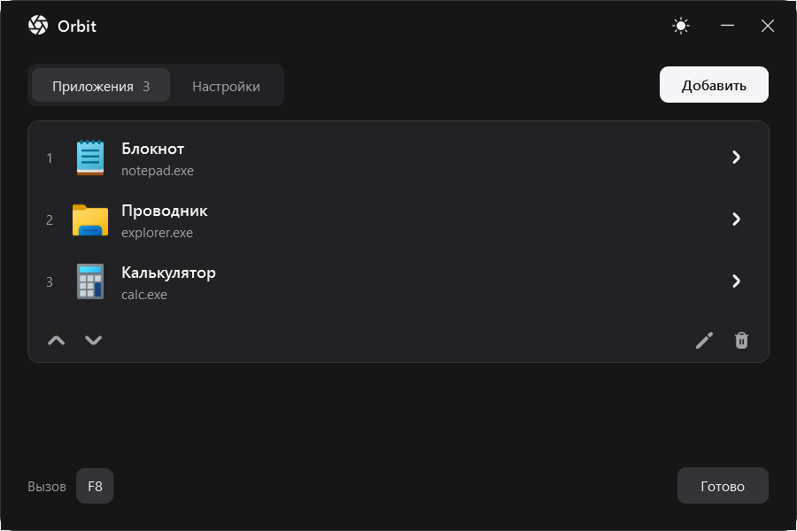

<p align="center">
  
</p>

<h1 align="center">Orbit</h1>

<p align="center">
  Радиальное меню запуска и переключения приложений для Windows.<br>
  Удерживай кнопку. Выбери направление. Отпусти.
</p>

<p align="center">
  <a href="https://github.com/palychdev/Orbit/releases"></a>
  
  
  <a href="https://github.com/palychdev/Orbit/actions/workflows/windows.yml"></a>
</p>

<p align="center">
  <a href="https://github.com/palychdev/Orbit/releases/tag/v0.3.1"><strong>Скачать для Windows</strong></a>
  &nbsp; · &nbsp; <a href="#быстрый-старт">Быстрый старт</a>
  &nbsp; · &nbsp; <a href="https://github.com/palychdev/Orbit/issues">Сообщить об ошибке</a>
</p>

<picture>
  <source media="(prefers-color-scheme: dark)" srcset="docs/media/app-dark.png">
  <source media="(prefers-color-scheme: light)" srcset="docs/media/app-light.png">
  
</picture>

<p align="center"><sub>Настоящий интерфейс приложения. Тёмная и светлая темы доступны для окна и колеса.</sub></p>

## Одно движение вместо поиска окна

Orbit открывает колесо по центру монитора, на котором находится мышь. Курсор скрыт: выбор определяется направлением движения, а не попаданием в маленькую кнопку. Отпусти бинд — Orbit переключится на уже открытое окно или запустит приложение.

| Возможность | Как работает |
| :--- | :--- |
| **До 12 приложений** | Свои `.exe` и обычные ярлыки `.lnk`, порядок секторов задаётся списком |
| **Клавиатура или мышь** | Клавиша, средняя или боковая кнопка; сочетания с Ctrl, Alt и Shift |
| **Запуск и переключение** | Восстановление существующего окна; новый запуск, если подходящего окна нет |
| **Две темы** | Тёмная по умолчанию, светлая одним нажатием; слегка прозрачное колесо с размытием |
| **Работа из трея** | Автоматическое сохранение настроек, автозапуск по желанию |
| **Переносимая сборка** | Без установщика; среда .NET уже в архиве, настройки рядом с программой |

## Быстрый старт

1. Скачай `Orbit-0.3.1-win-x64.zip` из [релиза](https://github.com/palychdev/Orbit/releases/tag/v0.3.1).
2. Распакуй **весь архив** в папку с правом записи, например `Documents\Orbit`, и запусти `Orbit.exe`.
3. Добавь приложения. Порядок списка соответствует секторам **сверху по часовой стрелке**.
4. Удерживай **F8**, двинь мышь в сторону нужного приложения и отпусти кнопку.

Отдельно устанавливать .NET не нужно. Переноси папку целиком: один `Orbit.exe` без каталога `runtime` не запустится.

### Управление

| Действие | Результат |
| :--- | :--- |
| Удерживать бинд и двигать мышь | Открыть колесо и выбрать сектор |
| Отпустить бинд | Переключиться на приложение или запустить его |
| Нажать Esc | Отменить выбор |
| Отпустить бинд без движения | Закрыть колесо без запуска |
| Дважды нажать значок в трее | Открыть настройки |
| Нажать значок в трее правой кнопкой | Открыть меню с командой выхода |

Чтобы изменить бинд, нажми на него в настройках и затем нажми нужную клавишу или кнопку мыши. Поддерживаются средняя кнопка, Mouse 4 и Mouse 5; ЛКМ и ПКМ не назначаются. Выбранная кнопка перехватывается Orbit — учитывай сочетания, которыми пользуешься в других программах.

Закрытие окна настроек оставляет Orbit в трее. Для полного завершения выбери **«Выход»** в меню значка.

## Настройки и обновление

Размер колеса, чувствительность, тема, приложения и бинд сохраняются в `Data\settings.json` рядом с программой. Для обновления распакуй новую версию в отдельную папку и перенеси туда каталог `Data`.

Автозапуск по умолчанию выключен. Если переместил Orbit после его включения, выключи и включи эту настройку заново, чтобы обновить путь.

## Совместимость

- **Windows 10/11, x64.** Поддерживаются обычные `.exe` и ярлыки на них. URL, ярлыки Microsoft Store и специальные оболочки напрямую не поддерживаются.
- **Полноэкранные приложения.** Для игр предпочтителен режим без рамки. Эксклюзивный fullscreen может скрыть колесо или свернуть игру; универсальная совместимость с играми не заявляется. Внедрения в процессы и обходов защиты нет.
- **Переключение окон.** Windows иногда запрещает вывод чужого окна на передний план. В таком случае Orbit сообщает об этом, не создавая лишнюю копию программы. Приложения с повышенными правами требуют отдельной проверки.
- **Ввод.** Используется относительное движение Raw Input; абсолютный ввод некоторых планшетов не обрабатывается. Небольшие движения игнорируются, Esc и Alt+Tab отменяют выбор. Через 20 секунд колесо закрывается автоматически.
- **Сборки.** Релизы пока предварительные, исполняемые файлы не подписаны платным сертификатом.

## Разработка

Нужны Windows и **.NET 10 SDK**. Зависимостей NuGet нет.

```powershell
git clone https://github.com/palychdev/Orbit.git
cd Orbit
dotnet build Orbit.csproj -c Release
```

Для переносимой сборки запусти `./build-portable.ps1` в PowerShell. Скрипт добавляет установленную на машине среду .NET 10 Windows Desktop в папку `runtime`.

### Проверки

[Windows CI](https://github.com/palychdev/Orbit/actions/workflows/windows.yml) собирает приложение, выполняет регрессионные проверки и сохраняет отчёты со снимками WPF-интерфейса. Подробности и границы проверки — в [отчёте](docs/testing-v0.3.0.md).

| Режим запуска | Что проверяет |
| :--- | :--- |
| `--self-test` | Выбор секторов, состояния бинда, восстановление после ошибок, настройки и отрисовку |
| `--native-registration-test` | 100 циклов настоящей регистрации и снятия Raw Input |
| `--hook-test` | Установку и снятие мышиных хуков при смене бинда |
| `--native-test` | 40 открытий и закрытий колеса, восстановление положения и ограничений курсора |

Последний режим перемещает курсор: запускай его отдельно от работы с мышью. Эти проверки не заменяют ручной прогон в конкретной игре.

<details>
<summary>Фоновая работа и диагностика</summary>

При клавиатурном бинде глобальный мышиный хук не установлен. Raw Input регистрируется только на время колеса. Фон для размытия захватывается один раз при открытии и освобождается при закрытии; постоянного захвата экрана нет. При недоступном захвате используется заливка.

Режимы `--profile-keyboard` и `--profile-mouse` выполняют короткий замер простоя, сохраняют `idle-*.json` и завершаются. Таймеры профилирования работают только в этих режимах.

</details>

Правила оформления: [DESIGN.md](DESIGN.md). При сообщении об ошибке укажи версию Orbit, версию Windows, бинд и шаги воспроизведения; для проблем с отображением пригодится снимок экрана.

## Автор и ресурсы

Разработчик — [palychdev](https://github.com/palychdev).

Иконки интерфейса и логотип: [UIcons by Flaticon / Freepik](https://www.flaticon.com/uicons), solid rounded 3.3.1 — [лицензия](Assets/UIcons/LICENSE). Солнце и луна: [Bootstrap Icons](https://github.com/twbs/icons), 1.13.1 — [MIT](Assets/Bootstrap/LICENSE). Значки приложений извлекаются из Windows Shell и не перерисовываются.
